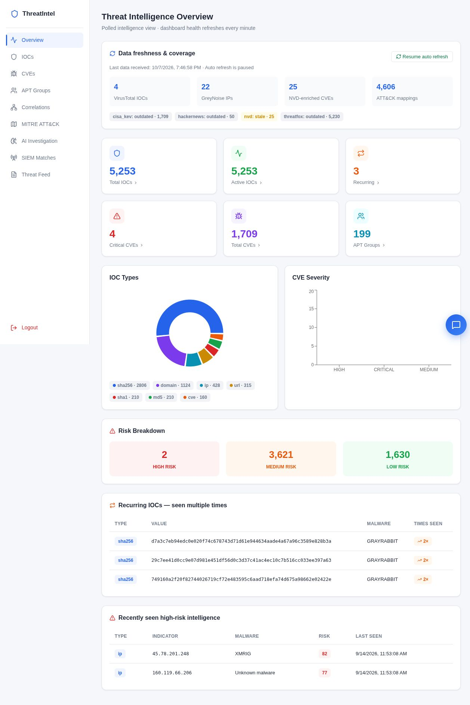

# ThreatIntel SOC Platform

> A self-hosted Cyber Threat Intelligence and SOC investigation platform that collects live threat data, normalizes and enriches indicators, correlates evidence, maps activity to MITRE ATT&CK, matches SIEM events, and supports analysts through an authenticated dashboard and local AI assistant.


## Live platform proof

The screenshot below is from the deployed local lab—not the base repository or a mock-up. At the time of capture, the platform contained **5,253 IOCs, 1,709 CVEs, 199 APT groups, and 4,606 ATT&CK mappings**.



See [Verified Achievements](docs/VERIFIED_ACHIEVEMENTS.md) for the evidence matrix and [Portfolio Evolution](docs/PORTFOLIO_EVOLUTION.md) for a clear account of the work added to the authorized base project.

## What I achieved

| Area | Implemented result | Proof |
|---|---|---|
| CTI ingestion | Multi-source collection from ThreatFox, CISA KEV, NVD, ransomware.live, The Hacker News/BleepingComputer and other configured feeds | Connector modules and pipeline runner |
| Data engineering | Normalization, deduplication, sightings, recurrence tracking and indexed PostgreSQL storage | `raw_items`, `iocs`, `ioc_sightings`, `cves`, `articles` |
| Enrichment | AbuseIPDB, Shodan, VirusTotal, GreyNoise and NVD enrichment with rate-limit-aware execution | Dedicated enrichment modules and dashboard coverage counters |
| Threat correlation | IOC ↔ malware ↔ APT ↔ CVE ↔ sighting evidence clusters | Correlation API and dashboard investigation page |
| MITRE ATT&CK | STIX-based actor, software, tactic and technique mapping | **4,606** stored mappings in the verified lab capture |
| AI investigation | Evidence-grounded, read-only investigation reports with deterministic fallback | FastAPI investigation endpoint and React analyst workflow |
| Natural-language assistant | Project-aware IOC, CVE, APT, enrichment and ATT&CK questions mapped to guarded read-only queries | Local Ollama `llama3.2` assistant with query controls |
| SIEM integration | Token-protected Wazuh/Elastic event ingestion and exact IOC/CVE matching | Wazuh level-10 SSH alert verified end to end; SIEM unit tests pass |
| Security | bcrypt password hashing, TOTP MFA, JWT sessions, TLS reverse proxy, CORS and security headers | Auth modules, nginx deployment and HTTPS lab |
| Operations | User-level systemd services, Wazuh SSH tunnel, pipeline monitoring, smoke test, database backup/restore | Deployment scripts and operations runbook |
| API-cost control | Scheduled refresh can be enabled/disabled so VirusTotal/GreyNoise quotas are not exhausted | Refresh-control script and documented commands |

The major portfolio implementation is recorded in commit `09d37b3`: **46 files changed, 3,827 insertions and 203 deletions** compared with the earlier upstream state.

## Verified lab snapshot

| Measurement | Verified value |
|---|---:|
| Total / active IOCs | 5,253 / 5,253 |
| Recurring indicators | 3 |
| CVEs | 1,709 |
| Critical CVEs | 4 |
| APT groups | 199 |
| MITRE ATT&CK mappings | 4,606 |
| VirusTotal-enriched IOCs | 4 |
| GreyNoise-enriched IPs | 22 |
| NVD-enriched CVEs | 25 |
| Risk distribution | 2 high · 3,621 medium · 1,630 low |

These values are a time-bound dashboard snapshot from **2026-10-07**, not hard-coded product promises. Operational verification continued on **2026-10-09**. Counts change when feeds are refreshed.

## Architecture

```text
Public CTI feeds                    MITRE STIX/TAXII
ThreatFox · KEV · NVD · News              │
Ransomware feeds · enrichment APIs         │
              │                            │
              └────────────┬───────────────┘
                           ▼
                 Connectors + raw JSONB
                           │
                           ▼
          Normalize · deduplicate · record sightings
                           │
          ┌────────────────┴────────────────┐
          ▼                                 ▼
 VirusTotal · GreyNoise              Ollama llama3.2
 AbuseIPDB · Shodan · NVD       extraction + investigation
          └────────────────┬────────────────┘
                           ▼
                     Risk scoring
                           │
                           ▼
                      PostgreSQL
        IOCs · CVEs · actors · ATT&CK · SIEM evidence
                 ┌─────────┴──────────┐
                 ▼                    ▼
        FastAPI + MFA/JWT      Wazuh/Elastic adapter
                 │                    │
                 └─────────┬──────────┘
                           ▼
                 nginx TLS reverse proxy
                           │
                           ▼
             React analyst dashboard + chatbot
```

## Analyst workflows

- **Overview:** live counts, feed freshness, enrichment coverage and risk distribution.
- **IOC investigation:** search/filter indicators, inspect sightings, reputation, infrastructure and recurring evidence.
- **CVE triage:** combine NVD CVSS/severity with CISA Known Exploited Vulnerabilities status.
- **APT intelligence:** actor-specific source evidence instead of repeated generic descriptions.
- **Correlations:** pivot across indicators, malware, actors, CVEs and source sightings.
- **MITRE ATT&CK:** inspect tactic coverage and actor-to-technique/software relationships.
- **AI Investigation:** generate a bounded analyst report only from stored evidence.
- **SIEM Matches:** ingest Wazuh/Elastic JSON, preserve the event and show exact local CTI matches.

## Security controls

- bcrypt-hashed administrator password and TOTP MFA
- signed, expiring JWT sessions
- TLS through nginx with same-origin API proxying
- restricted CORS and browser security headers
- dedicated `X-SIEM-Token` trust boundary for event ingestion
- SELECT-only chatbot validation, single-statement enforcement, forbidden keywords and query timeout
- evidence-bounded AI investigation with deterministic fallback
- `.env` and generated backups excluded from Git
- quota-aware enrichment with optional scheduled refresh

## Technology

- **Backend:** Python, FastAPI, psycopg2, python-jose, bcrypt, pyotp
- **Frontend:** React, Vite, Recharts, lucide-react, axios
- **Data:** PostgreSQL with JSONB landing zone and relational intelligence tables
- **AI:** local Ollama with `llama3.2`
- **Threat intelligence:** STIX/TAXII, MITRE ATT&CK, NVD, CISA KEV and IOC reputation APIs
- **SOC/operations:** Wazuh/Elastic adapter, nginx, systemd, SSH tunnel, backup/restore and smoke tests

## Quick start

Prerequisites: Python, Node.js, PostgreSQL, Ollama with `llama3.2`, and the API credentials listed in `backend/.env.example`.

```bash
git clone git@github.com:vijaychouhan26/ThreatIntel-SOC-Platform.git
cd ThreatIntel-SOC-Platform

cp backend/.env.example backend/.env
cp frontend/.env.example frontend/.env

cd backend
python -m venv venv
source venv/bin/activate
pip install -r requirements.txt
cd ..

./start_backend.sh

cd frontend
npm install
npm run dev -- --host 127.0.0.1 --port 5177
```

Never commit real API keys, database passwords, JWT secrets, SIEM tokens, MFA seeds or generated backups. Configure them only in ignored local `.env` files.

Development URLs:

- Dashboard: `http://127.0.0.1:5177`
- API documentation: `http://127.0.0.1:8006/docs`
- Secured lab deployment: `https://threatintel.local`

Initialize the admin account from `backend/` with `./venv/bin/python setup_admin.py`. Run the ingestion pipeline with `./run_pipeline.sh --force` only when feed/API quota use is intended.

## SIEM forwarding

Set a dedicated `SIEM_INGEST_TOKEN` locally and restart the API. Do not reuse the dashboard password or JWT secret.

```bash
python -c 'import secrets; print(secrets.token_urlsafe(32))'
python backend/siem_forwarder.py /path/to/wazuh-alert.json wazuh
```

The original payload is stored, exact IOC/CVE matches are recorded with provenance, and the dashboard remains read-only. Wazuh integration and replay-safe verification are documented in [Operations](docs/OPERATIONS.md).

## Verification

```bash
# SIEM tests
backend/venv/bin/python -m unittest discover -s tests -v

# Frontend production verification
cd frontend
npm run build
npm run lint

# Running-service smoke test
cd ..
./scripts/smoke_test.sh

# PostgreSQL custom-format backup
./scripts/backup_database.sh
```

Supporting documentation:

- [Verified Achievements](docs/VERIFIED_ACHIEVEMENTS.md)
- [Portfolio Evolution](docs/PORTFOLIO_EVOLUTION.md)
- [Operations Runbook](docs/OPERATIONS.md)
- [Deployment Checklist](docs/DEPLOY_CHECKLIST.md)
- [Interview Guide](docs/INTERVIEW_GUIDE.md)

## Project status

- [x] Multi-source CTI pipeline, normalization, deduplication and sightings
- [x] VirusTotal, GreyNoise, AbuseIPDB, Shodan and NVD enrichment
- [x] Composite risk scoring
- [x] MFA/JWT/TLS-secured analyst dashboard
- [x] Project-aware natural-language assistant
- [x] Threat correlation evidence graph
- [x] MITRE ATT&CK STIX mapping
- [x] Read-only AI-assisted investigation
- [x] Wazuh/Elastic SIEM ingestion and CTI matching
- [x] Monitoring, systemd services, smoke test and backup/restore
- [ ] Production CA-issued certificate and external hosting
- [ ] Approval-based response actions and firewall blocklist export
- [ ] Historical time-series analytics

## Ownership and provenance

This portfolio implementation was developed from an **authorized existing codebase** and substantially extended, integrated, secured, deployed and verified as a complete SOC lab. The claims above describe the work and evidence present in this repository; third-party data sources and trademarks remain the property of their respective owners.

**Portfolio implementation by [Vijay Chouhan](https://github.com/vijaychouhan26).**
